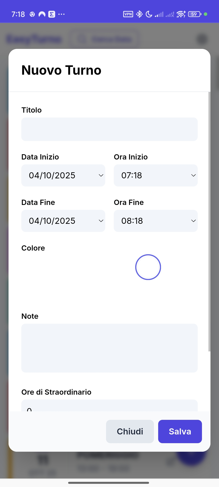
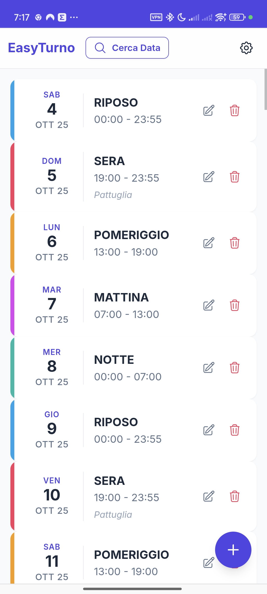
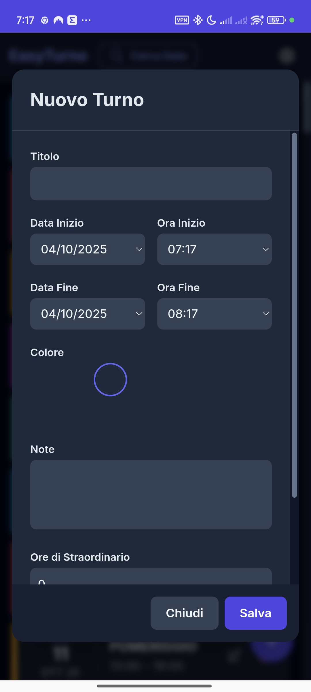
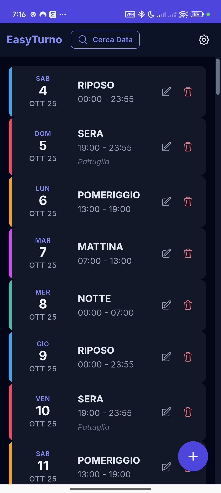

# EasyTurno

Offline-first PWA for work shift management, optimized for mobile devices.

Italian documentation is available in [README_IT.md](README_IT.md).

<p align="center">
  
  
  
  
</p>

## Key Features

- Create, edit, and delete single and recurring shifts (daily, weekly, monthly, yearly)
- List view with date search and pagination, plus monthly calendar view with swipe gestures
- Overtime tracking and multiple allowances per shift
- Statistics dashboard with period summaries for hours, overtime, and allowances
- JSON backup/restore with validation, including password-protected encrypted backups
- Light/dark theme with automatic system preference detection
- Italian/English localization
- Local data encryption with 256-bit AES-GCM
- Service worker with offline-first caching and PWA update detection
- Local notifications on native platforms (Android via Capacitor)

## Tech Stack

| Technology   | Version |
| ------------ | ------- |
| Angular      | 22.2.6  |
| TypeScript   | 6.0.3   |
| Tailwind CSS | 4.3.5   |
| Capacitor    | 8.6.2   |
| Firebase     | 13.4.0  |
| Jest         | 30.5.2  |
| Playwright   | 1.65.1  |

## Quick Start

```bash
# Requires Node.js ^22.22.3, ^24.15.0 (LTS), or >=26.0.0

# Install dependencies
npm install

# Development server (port 3000)
npm run dev

# Production build
npm run build

# Preview the production build
npm run preview
```

The development app is available by default at `http://localhost:3000/`.

## Useful Commands

```bash
# Linting and formatting
npm run lint            # Check ESLint issues
npm run lint:fix        # Fix auto-fixable ESLint issues
npm run format          # Format with Prettier
npm run format:check    # Verify formatting

# Tests
npm test                              # Jest unit tests (single run)
npm run test:watch                    # Jest in watch mode
npm run test:coverage                 # Coverage report (output in coverage/)
npx jest scripts/check-csp.spec.ts    # Verify CSP headers and built dist/ output
npm run test:pw:install               # Install Chromium for Playwright
npm run test:pw                       # Playwright browser E2E suite
npm run test:pw:ui                    # Playwright UI mode
npm run test:pw:headed                # Playwright headed mode
npx tsc --noEmit                      # Standalone type check

# Mobile (Capacitor)
npm run build:mobile    # Build + Capacitor sync
npm run android:dev     # Open Android Studio
```

## Architecture

The application uses Angular standalone components with signal-based state management, `@defer` code splitting, and `OnPush` change detection (with zoneless change detection at runtime).

```text
sw.js                           # Service Worker v7 (cache-first hashed chunks, SWR + LRU, SKIP_WAITING)
src/
  app.component.ts/html         # Main shell, signals, and lazy @defer boundaries
  shift.model.ts                # Shift, ShiftSeries, ManualShift, ShiftOverride interfaces
  environments/
    firebase.config.ts          # Firebase web client config
  utils/
    lazy-loader.ts              # Memoized dynamic import helper
  components/
    auth-screen.component.ts              # Email/password, Google Sign-In, guest entry
    email-verification-screen.component.ts# Email verification gate & resend timer
    shift-form-modal.component.ts         # Shift create/edit modal
    statistics-drawer.component.ts        # Analytics drawer (periods, overtime, allowances)
    settings-drawer.component.ts          # Theme, language, notifications, account, devices, backup
    confirm-dialog.component.ts           # Confirmation, password, and date-search dialogs
    calendar.component.ts                 # Calendar view with touch & keyboard navigation
    shift-list-item.component.ts          # Shift card
    toast-container.component.ts          # Toast notifications
  services/
    shift.service.ts            # Shift CRUD, recurrences, encrypted local/cloud facade
    occurrence-generator.ts     # Pure range-based occurrence + override materializer
    user-data.service.ts        # Single local/cloud ShiftDataState boundary
    firestore-user-data.service.ts # Lazy Firestore listeners, batch writes, device registry
    firebase-app.service.ts     # Lazy Firebase initialization + persistentLocalCache
    auth.service.ts             # Firebase Auth + guest mode state
    sync.service.ts             # Sync status orchestration & device registration
    device.service.ts           # Device ID, platform detection, installed-device soft limit
    crypto.service.ts           # 256-bit AES-GCM encryption & PBKDF2 backups
    calendar.service.ts         # Calendar navigation and day grid
    translation.service.ts      # Internationalization with per-language lookup cache
    notification.service.ts     # Lazy Capacitor local notifications
    push-notification.service.ts# Lazy Capacitor FCM push registration
    toast.service.ts            # Toast UI
    sw-update.service.ts        # PWA Service Worker update detection & activation
  pipes/
    translate.pipe.ts           # Memoized translation pipe
    date-format.pipe.ts         # Memoized localized date pipe
  assets/i18n/                  # Translation JSON files (it.json, en.json)
```

## Security

- Data encrypted in `localStorage` with 256-bit AES-GCM
- Device key persisted preferably in IndexedDB; legacy fallback to `localStorage` only when IndexedDB is unavailable
- Exportable backups encrypted with a user password (`PBKDF2` + `AES-GCM`)
- Hardened Content Security Policy (CSP), with `unsafe-inline` still allowed in local development for `ng serve` compatibility
- Automatic migration of legacy unencrypted data

### Security model

- **Data at rest** is encrypted with a per-device AES-GCM 256-bit key. When IndexedDB is available the key is stored as a **non-extractable `CryptoKey`** (`extractable: false`): the raw key bytes never leave the browser cryptography context. A small ciphertext header (`ETBLOB1:`) marks each encrypted record so legacy formats can be migrated transparently.
- **The device key is unique to this browser profile on this device.** It is **not** derived from a password and is **not** synchronized to any backend. Clearing the browser data, switching device or losing the storage destroys the key — and with it the ability to read the encrypted shifts. **There is no recovery path** other than restoring a previously exported backup.
- **Encrypted backups** are produced with `PBKDF2-SHA256` (600 000 iterations) + AES-GCM keyed from the user-supplied password. Backups created before the 600 000-iter bump (e.g. 250 000 iter) are still decryptable thanks to the per-payload `iterations` field, but new exports always use the current parameters. The app **always requires a password ≥ 12 characters** at export time: there is **no plaintext export path**.
- **Imports** accept either the password-protected format (most cases) or, only for backward compatibility, a legacy unencrypted JSON file. After import the shifts are immediately re-saved through the encrypted on-disk format.
- **Server-side hardening**: the deployed app ships `_headers` (Cloudflare Pages / Netlify) with strict CSP, HSTS (`preload` + `includeSubDomains`), `X-Content-Type-Options`, COOP / CORP `same-origin`, restrictive `Permissions-Policy`, and `frame-ancestors 'none'`. The PWA cannot be embedded in iframes.
- **Recommendation**: export an encrypted backup as soon as you accumulate non-trivial data. The first time you reach **5 shifts** the app shows a one-time reminder; you can repeat the export from Settings any time. Without a backup, a lost device or a cleared profile equals lost data.

Important note:

- Local storage encryption is useful against casual data exposure, but it is not strong protection against attackers who gain access to the browser execution context.
- The local encryption key is still managed in the same client context as the data, so its real protection level is lower than that of password-protected encrypted backups.
- The two recommended architectural evolutions to close this gap are:
  1. user password for local storage, with a key derived at each unlock and kept only in memory;
  2. a secret kept outside `localStorage`, such as an authenticated backend or Capacitor secure native storage.
- Of the two, the first is the recommended direction for this project in terms of simplicity, security, and reliability.

## Current Status

- Build verified with Angular 22.2.6, TypeScript 6.0.3, Tailwind CSS 4.3.5, and Firebase 13.4.0
- Bundle optimization with `@defer` lazy views, lazy Firebase/Capacitor SDK loading, and production bundle budgets enforced in `angular.json`
- Cloud synchronization with Firebase Firestore (`ShiftSeries`, `ManualShift`, `ShiftOverride`) implemented and tested
- Full Authentication (Email/Password + verification, Google Login, cloud-safe account deletion) complete
- Unit tests: **33 suites, 742 tests passing** (including Service Worker, PWA manifest, CSP, CI config, Sync, Auth, Firestore, and Push Notifications; >95% branch coverage)
- Playwright browser flows: **40/40 passing** across 6 E2E spec files
- Firebase Emulator Suite integrated for Auth + Firestore integration testing
- Push Notifications (FCM) configured and tested on native Android
- Adaptive Icons, Splash Screen, and release signing Keystore ready for Play Store submission
- Build, lint, and formatting checked and 100% clean

## Firebase Synchronization

Guest users save encrypted data locally. Authenticated users save series, manual shifts, and overrides in Firestore under `users/{uid}`. Firestore's offline cache enables networkless usage, and synchronization resumes automatically when connectivity is restored.

### Known Limitations

- The per-account soft limit is set to **3 linked installations** (native Android app or installed PWA); plain web browser tabs are unlimited, and inactive devices (>90 days) are auto-pruned or manually removable from Settings.
- Synchronization requires an email-verified account or verification via Google Login.

## Firebase Emulator Suite

For local development and testing of synchronization and authentication, the project integrates the Firebase Emulator Suite:

```bash
# Start the local emulators (Auth and Firestore)
npm run emulators

# Run integration tests against the local emulator suite
npm run test:firebase
```

## Mobile Development (Capacitor & Android)

EasyTurno supports native Android export using **Capacitor 8**.

### Prerequisites

- **JDK 21** (required by Capacitor 8 / Gradle)
- **Android SDK** configured or Android Studio installed

### Mobile Development Commands

```bash
# Build the web application and sync assets with Android native folder
npm run build:mobile

# Open the native project in Android Studio for development/debugging
npm run android:dev

# Generate a signed production build (Release APK)
npm run android:build
```

Signing files (`release.keystore`), credential properties (`android/keystore.properties`), and the Google services configuration (`google-services.json`) are excluded from Git tracking for security reasons, but are preconfigured inside the Gradle configuration.

## Browser E2E

The project uses **Playwright** on Chromium with automatic dev-server management (`npm run dev:pw`) for all browser end-to-end tests:

- `playwright.config.ts` - runner, browser, and web server configuration
- `playwright/tests/smoke.spec.ts` - smoke tests for app bootstrap, calendar toggle, and shift creation
- `playwright/tests/app-flows.spec.ts` - core browser flows: persistence, CRUD, theme/language, calendar, reset, recurring edit/delete, statistics, encrypted backup/import with password, and decryption error handling
- `playwright/tests/calendar-offline.spec.ts` - full calendar navigation, dark mode/mobile gestures, offline persistence (`easyturno_user_data_v2`), recurring split edits, allowances, and bidirectional i18n
- `playwright/tests/fase3-fixes.spec.ts` - toast visibility outside modals, Tailwind v4 backdrop opacity, calendar color borders, and English statistics i18n
- `playwright/tests/fase4-optimization.spec.ts` - guest boot zero-Firebase lazy loading, `@defer` chunk loading, and offline Service Worker chunk caching
- `playwright/tests/fase5-pwa-perf.spec.ts` - Service Worker `SKIP_WAITING` update lifecycle, cache-first hashed chunk serving, PWA manifest/icons, focus trap/restore, and keyboard calendar navigation
- `playwright/tests/helpers.ts` - shared helpers for bootstrap and shift creation

## License

[MIT](LICENSE) - Copyright (c) 2025 Leonardo
