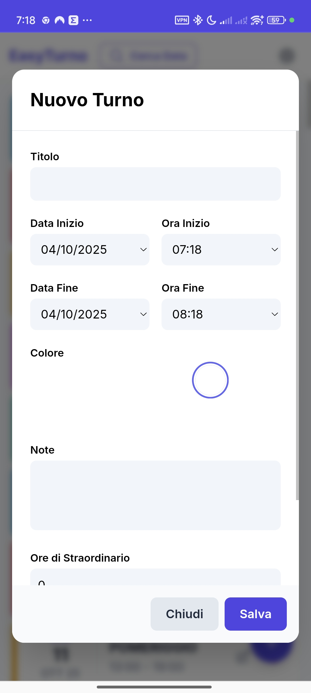
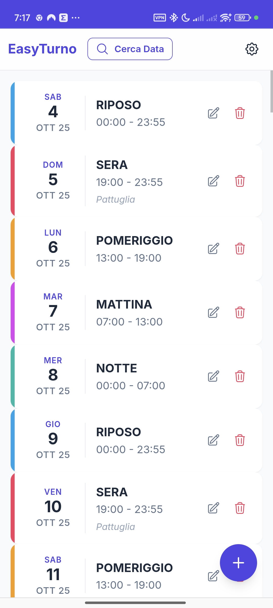
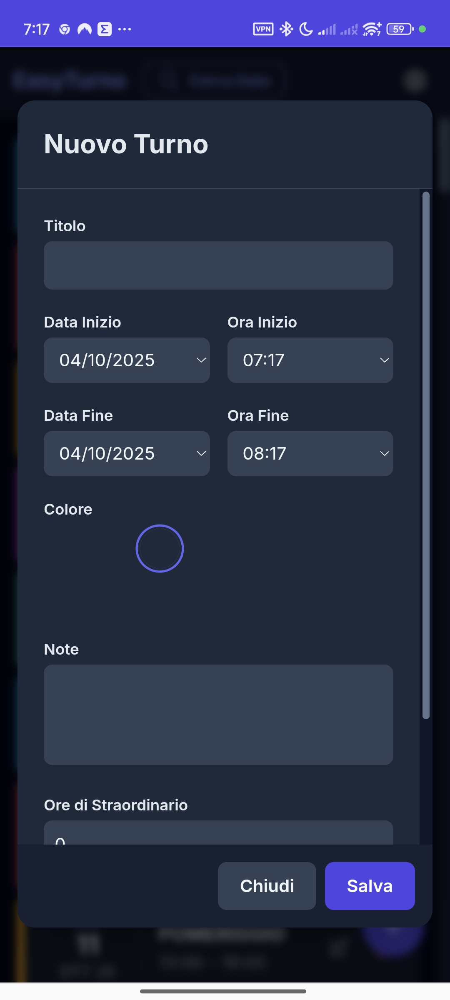
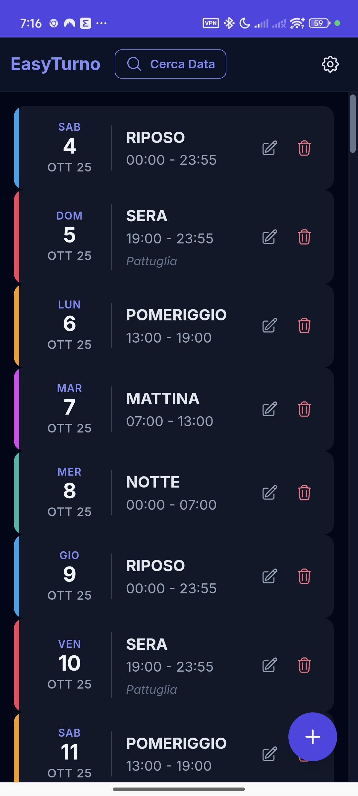

# EasyTurno

PWA per la gestione dei turni di lavoro, offline-first, ottimizzata per mobile.

English documentation is available in [README.md](README.md).

<p align="center">
  
  
  
  
</p>

## Funzionalita principali

- Creazione, modifica e cancellazione turni singoli e ricorrenti (giornalieri, settimanali, mensili, annuali)
- Vista lista con ricerca per data e paginazione, vista calendario mensile con gesture swipe
- Tracciamento straordinari e indennita multiple per turno
- Dashboard statistiche con riepilogo ore, straordinari e indennita per periodo
- Backup/ripristino dati in formato JSON con validazione, con supporto a backup cifrati protetti da password
- Tema chiaro/scuro con rilevamento automatico preferenza di sistema
- Multilingua italiano/inglese
- Dati cifrati localmente con AES-GCM 256-bit
- Service worker con caching offline-first e rilevamento aggiornamenti PWA
- Notifiche locali su piattaforme native (Android via Capacitor)

## Stack tecnologico

| Tecnologia   | Versione |
| ------------ | -------- |
| Angular      | 22.2.6   |
| TypeScript   | 6.0.3    |
| Tailwind CSS | 4.3.5    |
| Capacitor    | 8.6.2    |
| Firebase     | 13.4.0   |
| Jest         | 30.5.2   |
| Playwright   | 1.65.1   |

## Avvio rapido

```bash
# Richiede Node.js ^22.22.3, ^24.15.0 (LTS) o >=26.0.0

# Installazione dipendenze
npm install

# Server di sviluppo (porta 3000)
npm run dev

# Build di produzione
npm run build

# Preview build di produzione
npm run preview
```

L'app di sviluppo e disponibile di default su `http://localhost:3000/`.

## Comandi utili

```bash
# Lint e formattazione
npm run lint            # Controlla errori ESLint
npm run lint:fix        # Correggi errori auto-fixabili
npm run format          # Formatta con Prettier
npm run format:check    # Verifica formattazione

# Test
npm test                              # Unit test Jest (singola esecuzione)
npm run test:watch                    # Unit test in watch mode
npm run test:coverage                 # Report copertura (output in coverage/)
npx jest scripts/check-csp.spec.ts    # Verifica header CSP e build dist/
npm run test:pw:install               # Installa Chromium per Playwright
npm run test:pw                       # Suite E2E browser con Playwright
npm run test:pw:ui                    # Playwright UI mode
npm run test:pw:headed                # Playwright headed mode
npx tsc --noEmit                      # Type check standalone

# Mobile (Capacitor)
npm run build:mobile    # Build + sync Capacitor
npm run android:dev     # Apri Android Studio
```

## Architettura

L'applicazione usa standalone components Angular con signal-based state management, code splitting `@defer` e `OnPush` change detection (con zoneless change detection a runtime).

```text
sw.js                           # Service Worker v7 (cache-first chunk hash, SWR + LRU, SKIP_WAITING)
src/
  app.component.ts/html         # Shell principale, signals e blocchi lazy @defer
  shift.model.ts                # Interfacce Shift, ShiftSeries, ManualShift, ShiftOverride
  environments/
    firebase.config.ts          # Configurazione client Firebase Web
  utils/
    lazy-loader.ts              # Helper di import dinamico memoizzato
  components/
    auth-screen.component.ts              # Email/password, Google Login, accesso ospite
    email-verification-screen.component.ts# Gate verifica email e timer reinvio
    shift-form-modal.component.ts         # Modale creazione/modifica turno
    statistics-drawer.component.ts        # Drawer statistiche (periodi, straordinari, indennita)
    settings-drawer.component.ts          # Tema, lingua, notifiche, account, dispositivi, backup
    confirm-dialog.component.ts           # Dialoghi di conferma, password e ricerca data
    calendar.component.ts                 # Vista calendario con gesture touch e navigazione tastiera
    shift-list-item.component.ts          # Card turno
    toast-container.component.ts          # Notifiche toast
  services/
    shift.service.ts            # CRUD turni, ricorrenze, facade persistenza locale/cloud
    occurrence-generator.ts     # Generatore puro di occorrenze su range + override
    user-data.service.ts        # Confine unico locale/cloud per ShiftDataState
    firestore-user-data.service.ts # Listener Firestore lazy, writeBatch e registro dispositivi
    firebase-app.service.ts     # Inizializzazione Firebase lazy + persistentLocalCache
    auth.service.ts             # Firebase Auth + stato modalita ospite
    sync.service.ts             # Orchestrazione stato sync e registrazione dispositivo
    device.service.ts           # ID dispositivo, rilevamento piattaforma, limite soft installazioni
    crypto.service.ts           # Cifratura AES-GCM 256-bit e backup PBKDF2
    calendar.service.ts         # Navigazione calendario e griglia giorni
    translation.service.ts      # Internazionalizzazione con cache per lingua
    notification.service.ts     # Notifiche locali native Capacitor (lazy)
    push-notification.service.ts# Registrazione push FCM Capacitor (lazy)
    toast.service.ts            # Toast UI
    sw-update.service.ts        # Rilevamento e attivazione aggiornamenti Service Worker PWA
  pipes/
    translate.pipe.ts           # Pipe traduzione memoizzata
    date-format.pipe.ts         # Pipe date localizzate memoizzata
  assets/i18n/                  # Traduzioni JSON (it.json, en.json)
```

## Sicurezza

- Dati cifrati con AES-GCM 256-bit in `localStorage`
- Chiave dispositivo persistita preferibilmente in IndexedDB; fallback legacy su `localStorage` solo dove IndexedDB non e disponibile
- Backup esportabili in formato cifrato con password utente (`PBKDF2` + `AES-GCM`)
- Content Security Policy (CSP) irrigidita, con eccezione `unsafe-inline` mantenuta in sviluppo locale per compatibilita con `ng serve`
- Migrazione automatica dati legacy non cifrati

### Modello di sicurezza

- **Dati a riposo** cifrati con una chiave AES-GCM 256-bit specifica del dispositivo. Quando IndexedDB e disponibile la chiave e salvata come **`CryptoKey` non estraibile** (`extractable: false`): i byte grezzi della chiave non escono mai dal contesto crittografico del browser. Un piccolo header sul ciphertext (`ETBLOB1:`) marca ogni record cifrato per consentire la migrazione trasparente dei formati legacy.
- **La chiave dispositivo e unica per questo profilo browser su questo dispositivo.** Non e derivata da una password e non e sincronizzata su alcun backend. Cancellare i dati del browser, cambiare device o perdere lo storage distrugge la chiave — e con essa la possibilita di leggere i turni cifrati. **Non esiste percorso di recovery** al di fuori del ripristino di un backup esportato in precedenza.
- **I backup cifrati** sono prodotti con `PBKDF2-SHA256` (600 000 iterazioni) + AES-GCM derivati dalla password utente. I backup creati prima dell'aumento a 600 000 iter (es. 250 000 iter) restano decifrabili grazie al campo `iterations` per-payload, ma i nuovi export usano sempre i parametri correnti. L'app **richiede sempre una password >= 12 caratteri** in export: **non esiste un percorso di export in chiaro**.
- **Gli import** accettano sia il formato protetto da password (caso normale) sia, solo per retrocompatibilita, file JSON legacy in chiaro. Subito dopo l'import i turni vengono ri-salvati nel formato cifrato locale.
- **Hardening server-side**: la build pubblica spedisce `_headers` (Cloudflare Pages / Netlify) con CSP strict, HSTS (`preload` + `includeSubDomains`), `X-Content-Type-Options`, COOP / CORP `same-origin`, `Permissions-Policy` restrittivo e `frame-ancestors 'none'`. La PWA non puo essere embeddata in iframe.
- **Raccomandazione**: esporta un backup cifrato non appena hai accumulato dati non banali. La prima volta che raggiungi **5 turni** l'app mostra un promemoria una tantum; puoi rilanciare l'export da Impostazioni in qualsiasi momento. Senza backup, un device perso o un profilo cancellato equivalgono a dati persi.

Nota importante:

- La cifratura dello storage locale protegge bene da letture casuali dei dati, ma non equivale a una protezione forte contro attaccanti che ottengono accesso al contesto browser dell'utente.
- Al momento la chiave usata per la cifratura locale e ancora gestita nello stesso contesto client dei dati; per questo il livello di protezione reale dello storage locale e inferiore a quello dei nuovi backup cifrati con password.
- Le due evoluzioni architetturali consigliate per chiudere questo limite sono:
  1. password utente per lo storage locale, con chiave derivata a ogni sblocco e mantenuta solo in memoria;
  2. secret esterno al `localStorage`, ad esempio backend autenticato o secure storage nativo via Capacitor.
- Tra le due, la prima e la soluzione consigliata per questo progetto per rapporto tra semplicita, sicurezza e affidabilita.

## Stato attuale

- Build verificata con Angular 22.2.6, TypeScript 6.0.3, Tailwind CSS 4.3.5 e Firebase 13.4.0
- Ottimizzazione bundle con viste lazy `@defer`, lazy loading degli SDK Firebase/Capacitor e budget di produzione in `angular.json`
- Sincronizzazione cloud con Firebase Firestore (`ShiftSeries`, `ManualShift`, `ShiftOverride`) implementata e testata
- Autenticazione completa (Email/Password + verifica email, Google Login, eliminazione account con pulizia cloud)
- Unit test: **33 suite, 742 test verdi** (inclusi Service Worker, manifest PWA, CSP, configurazione CI, Sync, Auth, Firestore e Push Notifications; branch coverage >95%)
- Playwright browser flows: **40/40 verdi** su 6 file di test E2E
- Emulator Suite Firebase integrata per test di integrazione Auth + Firestore
- Notifiche Push (FCM) configurate e testate su Android nativo
- Generazione icone adaptive, splash screen e Keystore di firma pronti per il Play Store
- Build, lint e formattazione verificati puliti al 100%

## Sincronizzazione Firebase

Gli utenti ospite salvano i dati cifrati localmente. Gli utenti autenticati salvano serie, turni manuali e override in Firestore sotto `users/{uid}`. La cache offline Firestore consente l'uso senza rete e la sincronizzazione riprende quando la connessione torna disponibile.

### Limitazioni note

- Il limite soft per account è impostato a **3 installazioni collegate** (app Android nativa o PWA installata); le sessioni da browser web standard non contano nel limite e i dispositivi inattivi (>90 giorni) vengono rimossi automaticamente o manualmente da Impostazioni.
- La sincronizzazione richiede un account verificato via email o tramite provider Google.

## Firebase Emulator Suite

Per lo sviluppo e il testing locale della sincronizzazione e dell'autenticazione, il progetto integra la suite di emulatori Firebase:

```bash
# Avvia gli emulatori in locale (Auth e Firestore)
npm run emulators

# Esegue i test di integrazione Firebase agganciati all'emulatore locale
npm run test:firebase
```

## Sviluppo Mobile (Capacitor & Android)

EasyTurno supporta l'esportazione nativa per Android tramite **Capacitor 8**.

### Requisiti di sistema

- **JDK 21** (necessario per Capacitor 8 / Gradle)
- **Android SDK** configurato o Android Studio installato

### Comandi per lo sviluppo mobile

```bash
# Build dell'applicazione web e sincronizzazione degli asset con Android
npm run build:mobile

# Apri il progetto nativo in Android Studio per lo sviluppo/debug
npm run android:dev

# Genera la build di produzione firmata (Release APK)
npm run android:build
```

I file di firma (`release.keystore`), le configurazioni delle credenziali (`android/keystore.properties`) e il file di integrazione Google (`google-services.json`) sono esclusi dal tracciamento Git per motivi di sicurezza, ma sono pre-configurati nei file Gradle dell'applicazione.

## E2E Browser

Il progetto usa **Playwright** su Chromium con gestione automatica del dev server (`npm run dev:pw`) per tutti i test browser end-to-end:

- `playwright.config.ts` - configurazione runner, browser e web server
- `playwright/tests/smoke.spec.ts` - smoke test su bootstrap app, toggle calendario e creazione turno
- `playwright/tests/app-flows.spec.ts` - flussi browser principali: persistenza, CRUD base, tema/lingua, calendario, reset dati, modifica/cancellazione ricorrenze, rendering statistiche, backup/import cifrato con password e gestione errore decryption
- `playwright/tests/calendar-offline.spec.ts` - navigazione calendario completa, dark mode/gesture mobile, persistenza offline (`easyturno_user_data_v2`), split ricorrenze, indennità e i18n bidirezionale
- `playwright/tests/fase3-fixes.spec.ts` - visibilità toast fuori dai modali, backdrop Tailwind v4, bordi colore calendario e traduzioni EN delle statistiche
- `playwright/tests/fase4-optimization.spec.ts` - avvio Guest senza download SDK Firebase, caricamento chunk `@defer` su richiesta e caching offline dei chunk via Service Worker
- `playwright/tests/fase5-pwa-perf.spec.ts` - ciclo update `SKIP_WAITING` del Service Worker, cache-first su chunk con hash, manifest/icone PWA, focus trap/restore dei modali e navigazione tastiera del calendario
- `playwright/tests/helpers.ts` - helper condivisi per bootstrap e creazione turno

## Licenza

[MIT](LICENSE) - Copyright (c) 2025 Leonardo
