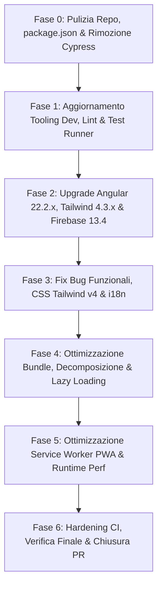

# update.md — Piano Operativo di Aggiornamento e Ottimizzazione EasyTurno PWA

Questo documento descrive la roadmap tecnica **passo-passo** per aggiornare, mettere in sicurezza e ottimizzare **EasyTurno** come Web PWA a partire da un clone pulito del branch `main` (`b4ce8d7`).

> **Ambito corrente:** solo **Web PWA** (dipendenze npm, sicurezza, toolchain CI, architettura Angular, bundle size, Service Worker e test).
> **Escluso per ora:** build nativa Android (`android/`, Gradle/AGP, `cap sync`, `npm run build:mobile`, `npm run android:build` e test su device fisico).

---

## Regole Operative

1. **Un blocco alla volta:** completare ogni step e superare il relativo **Gate di verifica** prima di passare al successivo.
2. **Commit atomici sul branch di lavoro:** lavorare sul branch dedicato (`chore/pwa-update-plan` o feature branch derivati), senza toccare direttamente `main` fino al merge finale.
3. **Zero regressioni funzionali:** preservare tutti i selettori `data-cy` esistenti, la crittografia WebCrypto (`CryptoService`), la persistenza v2 (`ShiftSeries` / `ManualShift` / `ShiftOverride`) e i vincoli CSP in `index.production.html` e `_headers`.
4. **Riferimento locale isolato:** la cartella storica `EasyTurno_C_PWA` (con modifiche Stitch non committate) resta separata e intatta.

---

## 0. Baseline Misurata sul Clone Pulito (`main` @ `b4ce8d7`)

Dati reali raccolti all'avvio sul clone pulito (`Node v26.13.1`, `npm 11.20.0`; in CI `.github/workflows/ci.yml` usa `Node 22.x`):

### 0.1 Stato Dipendenze & Sicurezza (`npm outdated` / `npm audit`)

- **`npm audit --omit=dev`**: **62 vulnerabilità** (`2 low`, `21 moderate`, `34 high`, `5 critical`).
  - *Causa strutturale individuata:* pacchetti solo build/CLI (`@angular/build`, `@angular/cli`, `@angular/compiler-cli`, `@tailwindcss/postcss`, `@capacitor/cli`) e `@capacitor/android` sono attualmente elencati in `dependencies` invece che in `devDependencies`, facendo fallire `npm audit --omit=dev --audit-level=high` in CI a causa di dipendenze transitive di build (`vite`, `postcss`, `@babel/core`, `piscina`, `tar`, `undici`, `zod`, `@modelcontextprotocol/sdk`, `hono`, `pacote`).
  - I pacchetti runtime Angular (`21.2.13`) hanno advisory `high` risolti nelle patch/major successive.
  - `firebase@12.13.0` non presenta advisory diretti bloccanti in `--omit=dev`.
- **`npm audit` (completo incluse `devDependencies`)**: **138 vulnerabilità** (`2 low`, `41 moderate`, `88 high`, `7 critical`), alimentate soprattutto da `ts-jest`, `jest-preset-angular`, `cypress`, `eslint`, `@typescript-eslint/*`, `postcss`, `vite`, `firebase-tools`.
- **PR Dependabot attualmente aperte su GitHub (10):**
  - `#41` Angular group (`22.1.x`) · `#30` `typescript` (`5.9.3 → 6.0.3`) · `#32` `zone.js` (`0.15.1 → 0.16.2`) · `#35` `vite` (`7.3.3 → 8.0.14`)
  - `#40` Linting group (`eslint`, `@typescript-eslint/*`, `prettier`, `eslint-plugin-prettier`) · `#31` `lint-staged` (`17.0.4 → 17.0.5`)
  - `#37` `ts-jest` (`29.4.9 → 29.4.11`) · `#36` `@types/node` (`25.8.0 → 25.9.1`) · `#18` `@playwright/test` (`1.58.2 → 1.59.1`) · `#6` `start-server-and-test` (`2.1.5 → 3.0.0`)

### 0.2 Stato Test & Build di Baseline

| Controllo | Risultato baseline | Note osservate |
|---|---|---|
| `npm run lint` | ✅ Verde (0 errori) | — |
| `npm run format:check` | ✅ Verde | — |
| `npm test -- --coverage --watchAll=false` | ✅ 25/25 suite (`687 passed, 2 skipped`) | `98.32%` Stmts, `94.73%` Branch, `96.83%` Funcs, `99.18%` Lines. I 2 skipped in `scripts/check-csp.spec.ts` diventano `19/19 passed` dopo `ng build`. |
| `npm run build` | ✅ Compilato in 5.50 s | **Initial total: `1.34 MB` raw / `310.52 kB` transfer** (`main` `1.27 MB` / `299.20 kB`, `styles` `66.28 kB` / `8.23 kB`, `chunk` `8.49 kB` / `3.08 kB`). **Lazy chunks:** solo `web` (`3.43 kB` / `925 B`). |
| Analisi modulo bundle (`ng build --stats-json`) | ⚠️ Sbilanciato | Prime voci non minificate: `@angular/compiler` **`1008.1 KiB`** (importato inutilmente in `index.tsx`!), `@angular/core` `977.9 KiB`, `@firebase/firestore` `939.0 KiB`, `(app-src)` `484.7 KiB`, `@firebase/auth` `424.2 KiB`. |
| `npm run test:pw` | ⚠️ Non eseguito per browser mancante | `@playwright/test@1.60.0` cerca `chromium_headless_shell-1223`, mentre in `~/.cache/ms-playwright` è presente `1255`: serve `npm run test:pw:install`. |

---

## Roadmap degli Interventi



---

## Fase 0 — Pulizia Repository, `package.json` e Consolidamento E2E

Obiettivo: eliminare file residui, disallineamenti tra `dependencies` e `devDependencies` e duplicazione Cypress/Playwright prima di toccare le versioni dei pacchetti.

### Step 0.1 — Rimozione artefatti residui tracciati in root
- [x] Rimuovere dal tracciamento Git i file spuri presenti in root su `main`:
  - `cypress_output.txt`
  - `easyturno@0.0.0`
  - `prettier` (file vuoto)
  - `screen2.png`
- [x] Verificare che nessun file di configurazione o test li referenzi.

### Step 0.2 — Pulizia `tsconfig.json` da residui non Angular
- [x] Aprire `tsconfig.json` e rimuovere opzioni ereditate da template React/AI Studio non usate dal progetto Angular:
  - `"jsx": "react-jsx"`
  - `"allowJs": true` (verificare prima che nessun file `.js` venga compilato da `tsc`)
  - verificare l'effettivo utilizzo di `"paths": { "@/*": ["./*"] }` (non risulta usato in `src/`)
  - mantenere `"disableTypeScriptVersionCheck": true` solo se necessario durante la transizione, poi rimuoverlo dopo Fase 2.1.

### Step 0.3 — Consolidamento E2E su Playwright e rimozione Cypress
- [x] Verificare gli scenari in `cypress/e2e/*.cy.ts` non ancora coperti dai 17 test in `playwright/tests/{smoke,app-flows}.spec.ts`:
  - navigazione mesi avanti/indietro/oggi e cambio anno in `CalendarComponent` (`calendar-view.cy.ts`)
  - simulazione reale offline (`context.setOffline(true)`) e verifica persistenza su `easyturno_user_data_v2` (in `offline-functionality.cy.ts` il vecchio test controllava la chiave legacy `easyturno_shifts` e non attivava davvero lo stato offline).
- [x] Aggiungere i nuovi test mancanti a `playwright/tests/`.
- [x] Rimuovere Cypress e relativi file/script (`cypress/`, `cypress.config.ts`, `cypress_output.txt`, voci Cypress in `.gitignore` ed `eslint.config.js`, script `cypress:open`, `cypress:run`, `dev:e2e`, `e2e` in `package.json`).
- [x] Disinstallare `cypress`, `@cypress/angular`, `start-server-and-test` (consente anche di chiudere la PR Dependabot `#6` e riduce vulnerabilità e tempi di `npm ci`).
- [x] Aggiornare `.github/dependabot.yml` rimuovendo i pattern `cypress` / `@cypress/*` dal gruppo `testing`.

### Step 0.4 — Correzione `dependencies` vs `devDependencies` in `package.json`
- [x] Spostare in `devDependencies` tutti i pacchetti usati **solo in fase di build/CLI/sviluppo**, che oggi falsano `npm audit --omit=dev`:
  - `@angular/build`
  - `@angular/cli`
  - `@angular/compiler-cli`
  - `@tailwindcss/postcss`
  - `@capacitor/cli`
  - `@capacitor/android` *(spostato come individuato al §0.1; eliminato advisory critical in `--omit=dev`)*
  - *(Nota: valutare se spostare in `devDependencies` anche `@angular/compiler` una volta completato lo Step 4.1, poiché con AOT non è più importato a runtime, oppure lasciarlo finché richiesto dai peer di `@angular/core`.)*
- [x] Tenere invece in `dependencies` solo i pacchetti realmente importati nel bundle client (`@angular/common`, `@angular/core`, `@angular/forms`, `@angular/platform-browser`, `firebase`, `rxjs`, e gli `@capacitor/*` importati da `src/` finché resta il supporto cross-platform — mantenuti in `dependencies` anche i 5 plugin runtime nativi `app`, `haptics`, `share`, `splash-screen`, `status-bar`).

**Gate Fase 0:**
```bash
npm run lint && npm run format:check && npm test -- --coverage --watchAll=false && npm run build
```

---

## Fase 1 — Aggiornamento Tooling Dev, Linting e Test Runner

Obiettivo: chiudere gli aggiornamenti a basso rischio prima del salto di major di Angular.

### Step 1.1 — Gruppo Linting & Formatting (assorbe PR `#40` e `#31`)
- [x] Aggiornare al latest compatibile:
  - `eslint` (`10.4.0 → 10.15.0`) e `@eslint/js` (`10.0.1`)
  - `@typescript-eslint/eslint-plugin` e `@typescript-eslint/parser` (`8.59.3 → 8.73.0`, sempre in coppia allineata)
  - `prettier` (`3.8.3 → 3.10.1`), `eslint-plugin-prettier` (`5.5.5 → 5.5.7`), `eslint-config-prettier` (`10.1.8`), `prettier-plugin-tailwindcss` (`0.8.0 → 0.8.1`)
  - `lint-staged` (`17.0.5 → 17.6.1`)
- [x] Eseguire `npm run lint` e `npm run format:check`; correggere eventuali nuove regole o formattazioni segnalate (riformattati 4 file in `src/` per Prettier 3.10.1).

### Step 1.2 — Tipi Node, Jest e Playwright (assorbe PR `#36`, `#37`, `#18`)
- [x] Aggiornare `@types/node` dentro il range `^25.9.x` (`^25.9.9`, allineato a `typescript ~5.9.3` e CI `Node 22.x`).
- [x] Aggiornare in blocco lo stack Jest per Angular 21 (ultimo step prima di `jest-preset-angular@17`):
  - `jest` (`30.4.2 → 30.5.2`), `jest-environment-jsdom` (`30.4.1 → 30.5.2`), `ts-jest` (`29.4.9 → 29.4.15`, chiude advisory `critical` su `ts-jest`), `jest-preset-angular` (`^16.2.0` per compatibilità Angular 21); rimosso `"overrides": { "handlebars": "4.7.9" }` da `package.json` perché `ts-jest@29.4.15` richiede `handlebars@^4.7.10`.
- [x] Aggiornare `@playwright/test` (`1.60.0 → 1.65.1`) e scaricare il browser allineato (`npx playwright install chromium` su `chromium-1255`; `npm run test:pw:install` con `--with-deps` richiede `sudo` interattivo in ambiente locale):
  ```bash
  npm run test:pw:install
  ```
- [x] Eseguire l'intera suite Playwright per verificare che tutti i test E2E passino localmente (`npm run test:pw`: `30/30 passed`).

**Gate Fase 1:**
```bash
npm run lint && npm run format:check && npm test -- --coverage --watchAll=false && npm run build && npm run test:pw
```

---

## Fase 2 — Aggiornamento Core Framework (Angular 22.2.x), Styling e Firebase 13.4

Obiettivo: portare l'applicazione ad Angular `22.2.x`, Tailwind `4.3.x` e Firebase `13.4.x` rispettando rigorosamente i `peerDependencies` (senza forzare versioni incompatibili come TypeScript 7).

### Step 2.1 — Upgrade Angular `21.2.x` → `22.2.x` (assorbe PR `#41`, `#30`, `#32`, `#35`)
- [x] Verificare le note ufficiali di migrazione su `https://update.angular.dev` (21 → 22).
- [x] Eseguire la migrazione guidata tramite Angular CLI:
  ```bash
  npx ng update @angular/core@22 @angular/cli@22 --allow-dirty
  ```
  *(Migrazioni applicate: `ChangeDetectionStrategy.Eager` su `src/components/toast-container.component.ts`; rimosso `disableTypeScriptVersionCheck` e conflitto `NG4003` da `tsconfig.json` mantenendo `strictTemplates` attivo tramite fallback `?? 0` in `src/app.component.html:1613,1658`; aggiornato `setup-jest.js` a `BrowserTestingModule`/`platformBrowserTesting`.)*
- [x] Verificare/allineare le versioni core in base ai `peerDependencies` verificati di Angular `22.2.6`/`22.2.7`:
  - `@angular/{core,common,compiler,compiler-cli,forms,platform-browser}`: `^22.2.6` *(rimosso `@angular/platform-browser-dynamic` dopo migrazione `setup-jest.js`)*
  - `@angular/{cli,build}`: `^22.2.7`
  - `typescript`: **`~6.0.3`** (`@angular/compiler-cli@22.2.6` richiede `>=6.0 <6.1` — **NON** salire a `7.0.2`)
  - `zone.js`: **`~0.16.3`** (richiesto solo da `setup-jest.js` per TestBed; in runtime l'app usa già `provideZonelessChangeDetection()`)
  - `vite`: rimossa la dipendenza diretta inutilizzata (gestita da `@angular/build@22.2.7`)
  - `jest-preset-angular`: aggiornato a **`^17.0.3`** (compatibile con `@angular/core >=20 <23` e `typescript >=5.8`).
- [x] Eseguire `npx tsc --noEmit` (`0` errori) e `npx tsc -p tsconfig.spec.json --noEmit` (`213` errori pre-esistenti in 11 spec, `0` nuovi errori introdotti da TypeScript 6).

### Step 2.2 — Aggiornamento Tailwind CSS `4.3.x`
- [x] Aggiornare `tailwindcss` (`^4.2.2 → ^4.3.5`), `@tailwindcss/postcss` (`^4.2.2 → ^4.3.5`) e `postcss` (`^8.5.6 → ^8.5.33`).
- [x] Verificare il file CSS generato (`dist/styles-OWYY3EZV.css`, `65.25 kB` raw / `8.29 kB` transfer) con `@layer`, `.dark` (`474` match) e tutte le 8 palette turni.

### Step 2.3 — Aggiornamento Firebase SDK `12.13.0` → `13.4.0`
- [x] Consultare le release notes e i `.d.ts` di `firebase@13.4.0` (`firebase/app`, `firebase/auth`, `firebase/firestore`): nessuna breaking change su simboli/firme usati dall'app.
- [x] Aggiornare `firebase` a `^13.4.0` e `firebase-tools` dev-only a `^15.36.0`.
- [x] Verificare i mock in `setup-jest.js` (nessuna modifica necessaria alle firme Firebase).
- [ ] Verificare obbligatoriamente la sync reale con gli emulatori locali:
  ```bash
  npm run test:firebase
  ```
  *(Bloccato su questo host locale: `Error: Could not spawn java -version` — nessun runtime Java installato; stesso stato della baseline, da eseguire in ambiente con JDK o CI.)*
- [x] Verificare i test CSP in `scripts/check-csp.spec.ts` dopo `ng build` (`19/19 passed`, nessuna nuova origine richiesta da `firebase@13.4.0`).

### Step 2.4 — Verifica Peer Dependencies, `--legacy-peer-deps` e `npm audit`
- [x] Verificare `npm install` e `npm ci` puliti **senza** `--legacy-peer-deps` e rimuovere `--legacy-peer-deps` da `.github/workflows/ci.yml` (righe 28 e 76).
- [x] Allineare i pacchetti JS `@capacitor/*` alle ultime patch `8.x` (`core`/`cli`/`android` `^8.6.2`, `app@^8.1.2`, `haptics@^8.0.2`, `local-notifications@^8.3.1`, `push-notifications@^8.1.3`, `share@^8.0.3`, `splash-screen@^8.0.2`, `status-bar@^8.0.4`, senza toccare `android/`).
- [x] Aggiunto `"overrides": { "@grpc/grpc-js": "^1.14.7" }` (usato solo dal path Node di `@firebase/firestore@4.20.0`, escluso dal bundle browser) per risolvere `GHSA-m9gg-hp2v-232j` / `GHSA-f596-whhp-79r4` e verificare `npm audit --omit=dev --audit-level=high` (**`0` vulnerabilità**).

**Gate Fase 2:**
```bash
npm run lint && npm run format:check && npm test -- --coverage --watchAll=false && npm run build && npx jest scripts/check-csp.spec.ts && npm run test:pw && npm run test:firebase && npm audit --omit=dev --audit-level=high
```

---

## Fase 3 — Bug Fix Funzionali, Tailwind v4 e i18n Rilevati su `main`

Obiettivo: risolvere difetti reali individuati nella lettura diretta del codice su `b4ce8d7` prima di rifattorizzare i componenti.

### Step 3.1 — Fix visibilità Toast fuori dai modali (`src/app.component.html`)
- [x] **Problema rilevato:** in `src/app.component.html:1743`, `<app-toast-container></app-toast-container>` è annidato **dentro** `@if (activeModal() !== 'none')` (chiuso a riga 1744). Quando non ci sono modali aperti (o subito dopo `activeModal.set('none')` al salvataggio/eliminazione/reset/ricerca), i toast non vengono renderizzati nel DOM.
- [x] **Fix (TDD):**
  1. Aggiunti unit test in `src/app.component.spec.ts` e E2E in `playwright/tests/fase3-fixes.spec.ts` che verificano il rendering del toast a modale chiuso (dopo ricerca fuori range e dopo `executeReset()`).
  2. Spostato `<app-toast-container></app-toast-container>` al livello radice di `src/app.component.html` (fuori da `@if (activeModal() !== 'none')` e fuori da `@switch (authService.state().mode)`, così i toast risultano visibili anche a modale chiuso e nelle schermate Auth/verifica email senza duplicati).

### Step 3.2 — Fix backdrop modale incompatibile con Tailwind CSS v4
- [x] **Problema rilevato:** `src/app.component.html:331` usa `bg-opacity-50 ... bg-black`, utility rimossa in Tailwind v4 (produce sfondo nero pieno opaco invece di semitrasparente).
- [x] **Fix:** sostituito con `bg-black/50` (verificato `.bg-black\/50` in `dist/styles-OWYY3EZV.css` e alfa ~0.5 via Playwright/Jest) e verificata l'assenza di altre classi `*-opacity-*` deprecate in tutto `src/` (`0` occorrenze residue).

### Step 3.3 — Fix bordo colore turni in `CalendarComponent`
- [x] **Problema rilevato:** `src/components/calendar.component.ts` riga 237 (`[style.borderLeftColor]="shift.color"`) passa nomi token (`'sky'`, `'amber'`, `'rose'`, ...) anziché valori esadecimali validi CSS, rendendo il bordo sinistro invalido/trasparente nei dettagli del giorno selezionato.
- [x] **Fix (TDD):**
  1. Aggiunti 3 test in `src/components/calendar.component.spec.ts` (red → green) su `borderLeftColor` per `'sky'`, tutte le 8 chiavi `ShiftColor` e fallback sicuro.
  2. Usato `[style.borderLeftColor]="getShiftIndicatorColor(shift)"` (riutilizzando `COLOR_MAP`, con guard `Object.hasOwn`, validazione `CSS_COLOR_REGEX` e fallback a `COLOR_MAP.slate` `#64748B`), verificato anche via Playwright (`rgb(14, 165, 233)`).

### Step 3.4 — Rimozione stringhe italiane hardcoded nella modale Statistiche
- [x] **Problema rilevato:** in `src/app.component.html` (righe ~1409–1721) risultano stringhe hardcoded in italiano anche quando la lingua è inglese (`"Analisi e resoconto delle tue ore e indennità"`, `"turni"`, `"Dati calcolati in locale con successo"`, `"ore"`, `"Non ci sono turni pianificati in questo periodo..."`).
- [x] **Fix:** spostate tutte le stringhe in `src/assets/i18n/it.json` e `src/assets/i18n/en.json` aggiungendo 5 chiavi simmetriche (`statsSubtitle`, `statsShiftSingular`, `statsShiftPlural`, `statsCalculatedLocally`, `statsNoShiftsDescription`) e riutilizzando `hours`, raggiungendo `212` chiavi foglia in perfetta parità (`onlyIt: []`, `onlyEn: []`), collegate con `| translate` e verificate via Jest + Playwright EN empty/populated.

**Gate Fase 3:**
```bash
npm run lint && npm run format:check && npm test -- --coverage --watchAll=false && npm run test:pw
```

---

## Fase 4 — Ottimizzazione Architettura Angular & Riduzione Bundle Size

Obiettivo: abbattere drasticamente il bundle iniziale (`1.34 MB` raw / `310.52 kB` transfer) e migliorare manutenibilità e tempi di avvio su rete mobile.

### Step 4.1 — Rimozione del compilatore JIT (`@angular/compiler`) dal bundle client
- [ ] **Problema rilevato:** `index.tsx:1` contiene `import '@angular/compiler';`. L'analisi `ng build --stats-json` mostra che `@angular/compiler` pesa **`1008.1 KiB`** non minificati nel bundle iniziale, nonostante `@angular/build:application` compili in AOT!
- [ ] **Intervento:**
  1. Verificare che nessun file di produzione usi API JIT a runtime (`compileComponent`, ecc.).
  2. Rimuovere `import '@angular/compiler';` da `index.tsx` (lasciandolo eventualmente solo dove richiesto da testbed, se necessario).
  3. Misurare il calo di `main-*.js` (raw e transfer) dopo `npm run build` e verificare con `npm run test:pw`.

### Step 4.2 — Decomposizione del monolite `AppComponent`
- [ ] **Problema rilevato:** `src/app.component.html` è **1.746 righe** e `src/app.component.ts` è **1.276 righe**, impedendo il code splitting e rendendo complesso il template principale.
- [ ] **Intervento:** estrarre componenti standalone `OnPush` dedicati, preservando al 100% attributi `data-cy` e comportamento accessibile:
  - `ShiftFormModalComponent` (creazione/modifica turno, colori, straordinari, indennità, ricorrenza)
  - `StatisticsDrawerComponent` (preset temporali, date range, metriche ore/indennità, empty state)
  - `SettingsDrawerComponent` (tema, lingua, notifiche, account, gestione dispositivi, backup import/export)
  - `ConfirmDialogComponent` (conferme eliminazione turno/serie, modifica serie, reset dati, delete account, decryption error, password prompt, search date)
- [ ] Coprire ogni nuovo componente con unit test dedicati mantenendo la coverage globale ≥ 95%.

### Step 4.3 — Code Splitting con `@defer` & Lazy Loading Firebase per modalità Guest/Offline
- [ ] **Opportunità:** dopo l'estrazione dei componenti, quasi tutto il codice di modali, drawer e Firebase (`~1,560 KiB` unminified tra Firestore e Auth) può essere caricato **on-demand**:
  1. Avvolgere `ShiftFormModalComponent`, `StatisticsDrawerComponent`, `SettingsDrawerComponent` e i dialoghi secondari con `@defer (when activeModal() === '...')` in `app.component.html`, creando lazy chunk reali al posto del singolo monolito.
  2. Disaccoppiare il caricamento di `firebase/firestore` (`939 KiB`) e `firebase/auth` (`424 KiB`) tramite `import()` dinamici nei service boundary (`FirebaseAppService` / `FirestoreUserDataService` / `AuthService`): quando l'utente sceglie **"Continua senza account" (Guest)**, non scaricare né inizializzare l'SDK Firestore/Auth all'avvio!
- [ ] Verificare che i chunk lazy siano precachabili/gestiti correttamente dal Service Worker (`sw.js`) in modalità offline dopo il primo uso.

### Step 4.4 — Budget di Build & Valutazione Critical CSS (`angular.json`)
- [ ] Aggiungere `budgets` nella configurazione `production` di `angular.json` (tarati sui nuovi valori ottimizzati post Step 4.1–4.3, es. `initial` warning/error e `anyComponentStyle`).
- [ ] Valutare `optimization.styles.inlineCritical: true` verificando tramite `scripts/check-csp.spec.ts` e Playwright che non violi la CSP (`style-src 'self' 'unsafe-inline'` è già consentito).
- [ ] Verificare l'eventuale impatto di `@capacitor/*` importati direttamente (`AppComponent`, `DeviceService`, `NotificationService`, `PushNotificationService`) e valutare wrapper/import lazy se superano soglie rilevanti nel bundle web.

**Gate Fase 4:**
```bash
npm run lint && npm run format:check && npm test -- --coverage --watchAll=false && npm run build && npx jest scripts/check-csp.spec.ts && npm run test:pw
```
*(Registrare il confronto esatto dei kB raw/transfer prima vs dopo in fondo a questo file.)*

---

## Fase 5 — Ottimizzazione PWA, Service Worker e Performance Runtime

Obiettivo: rendere affidabile il ciclo di aggiornamento offline/PWA e fluidi i calcoli reattivi su dataset grandi.

### Step 5.1 — Fix ciclo aggiornamento Service Worker (`sw.js` ↔ `SwUpdateService`)
- [ ] **Problema rilevato:**
  - `sw.js` nell'evento `install` chiama incondizionatamente `self.skipWaiting()`. Questo impedisce al nuovo worker di restare nello stato `waiting`, rendendo sostanzialmente inattivo il banner *"Aggiornamento disponibile"* e il metodo `SwUpdateService.activateUpdate()` (`postMessage({ type: 'SKIP_WAITING' })`), e causando un reload improvviso della pagina via `controllerchange` mentre l'utente sta lavorando.
  - `SwUpdateService.checkForUpdates()` non controlla se `this.registration.waiting` sia già valorizzato subito dopo `navigator.serviceWorker.register('/sw.js')` (caso di update già scaricato in una sessione precedente).
- [ ] **Intervento (TDD):**
  1. Rimuovere `self.skipWaiting()` automatico dall'evento `install` in `sw.js`, attivandolo **solo** tramite il messaggio `SKIP_WAITING` verificato da `isSameOriginClient(event.source)`.
  2. In `SwUpdateService.checkForUpdates()`, controllare `if (this.registration.waiting && navigator.serviceWorker.controller)` per esporre subito `updateAvailable.set(true)`, oltre al listener `updatefound`.
  3. Aggiornare/aggiungere test in `sw-update.service.spec.ts` e testare l'aggiornamento SW reale.

### Step 5.2 — Strategia Cache & Pruning di `RUNTIME_CACHE` in `sw.js`
- [ ] **Problema rilevato:** `sw.js` applica `staleWhileRevalidate` anche ai file `.js` e `.css` generati con hash da Angular (`outputHashing: "all"`), generando richieste di rete superflue, e `RUNTIME_CACHE` (`easyturno-runtime-v1`) accumula all'infinito vecchi chunk hash tra una release e l'altra.
- [ ] **Intervento:**
  1. Applicare strategia **cache-first** per gli asset statici con hash nel nome file (`-[A-Z0-9]{8}\.(js|css|woff2?)$` o path `/chunk-*`, `/main-*`, `/styles-*`), lasciando `staleWhileRevalidate` per asset non hash-ati e `networkFirst` per le navigazioni HTML.
  2. Aggiungere pulizia/limitazione (LRU o pruning dei vecchi chunk al cambio versione `STATIC_CACHE`) per non saturare la quota cache del browser.
  3. Verificare che anche eventuali nuovi chunk lazy `@defer` vengano messi in cache al primo caricamento e funzionino offline.

### Step 5.3 — Ottimizzazione Pipe Pure/Impure & Calcolo Occorrenze
- [ ] **Analisi rilevata:** `TranslatePipe` (`src/pipes/translate.pipe.ts`) e `LangDatePipe` (`src/pipes/date-format.pipe.ts`) hanno `pure: false` e vengono rivalutate ad ogni ciclo di Change Detection per ogni turno visibile.
- [ ] **Intervento:**
  1. Introdurre memoizzazione interna per `(key/value, format, language)` nelle pipe (o helper basati su `Signal`/`Intl.DateTimeFormat` riutilizzabili) per evitare riformattazioni ripetute di date e lookup JSON identici ad ogni interazione UI.
  2. Profilare `ShiftService.materializeOccurrences`, `AppComponent.sortedShifts`, `AppComponent.generateList` e `CalendarComponent.shiftsByDay` con molte serie ricorrenti (es. 10 serie giornaliere su 2 anni = ~7.300 occorrenze), riducendo allocazioni `new Date(...)` ripetute nei sort/filter.

### Step 5.4 — Verifica Accessibilità & Manifest PWA
- [ ] Controllare `manifest.webmanifest` (icone, `shortcuts`, `start_url`, `theme_color`), meta tag PWA e contrasti/attributi `aria-*` nei componenti estratti e nei modali (es. `role="dialog"`, `aria-modal="true"`, focus management alla chiusura/apertura).

**Gate Fase 5:**
```bash
npm run lint && npm run format:check && npm test -- --coverage --watchAll=false && npm run build && npx jest scripts/check-csp.spec.ts && npm run test:pw
```

---

## Fase 6 — Hardening CI, Verifica Finale e Chiusura su GitHub

Obiettivo: allineare CI, documentazione e repository remoto.

### Step 6.1 — Allineamento CI (`.github/workflows/ci.yml`) & `engines`
- [ ] Verificare allineamento Node tra locale (`26.x`), `package.json` `engines` (`^20.19.0 || ^22.12.0 || >=24.0.0`) e CI (`node-version: [22.x]`; valutare aggiunta di `24.x` in matrix o upgrade a LTS corrente supportata da `firebase-tools` / Angular 22).
- [ ] Aggiungere in CI la verifica `scripts/check-csp.spec.ts` **dopo** `npm run build` (oggi in CI `jest` gira prima di `ng build`, quindi i 2 test su `dist/index.html` e `dist/_headers` vengono saltati!).
- [ ] Valutare l'aggiunta di un check automatico su bundle budget (`ng build` già fallisce se i `budgets` in `angular.json` vengono superati).

### Step 6.2 — Verifica Finale Completa
- [ ] Eseguire in sequenza pulita tutti i controlli:
  - `npm ci` (o `npm ci --legacy-peer-deps` se ancora necessario)
  - `npm audit --omit=dev --audit-level=high`
  - `npm run lint`
  - `npm run format:check`
  - `npm test -- --coverage --watchAll=false` (target: 100% verdi, Branch ≥ 95%)
  - `npm run build` + `npx jest scripts/check-csp.spec.ts`
  - `npm run test:pw` (100% verdi)
  - `npm run test:firebase` (100% verdi)

### Step 6.3 — Consegna & Pulizia PR GitHub
- [ ] Aggiornare `AGENT_HANDOFF.md`, `README.md` / `README_IT.md` (rimuovendo riferimenti a Cypress se eliminato) e il registro esecuzioni in questo `update.md`.
- [ ] Aprire una Pull Request pulita verso `main` su `Spe1977/EasyTurno_C_PWA`.
- [ ] Chiudere/sostituire le PR Dependabot assorbite dagli aggiornamenti completati (`#6`, `#18`, `#30`, `#31`, `#32`, `#35`, `#36`, `#37`, `#40`, `#41`).

---

## Appendice A — Manutenzione Periodica & Rischi Accettati

### Cadenza consigliata dopo il completamento della roadmap
- **Ogni 30 giorni (Sicurezza & Backend):** `npm outdated`, `npm audit --omit=dev`, aggiornamento patch `firebase` e verifica CSP/emulatore.
- **Ogni 60 giorni (Framework, Tooling & PWA):** patch/minor Angular/TypeScript/Tailwind/ESLint/Playwright, revisione bundle `budgets` e verifica `sw.js`.
- **Regola d'oro:** aggiornare un gruppo omogeneo alla volta e lanciare sempre `lint` + `test` + `build` + `check-csp` + `test:pw`.

### Rischi noti registrati dalla baseline precedente
- **`firebase-tools` → `uuid <11.1.1` (GHSA-w5hq-g745-h8pq):** 6 advisory `moderate` transitive; CLI dev/release-only senza esposizione runtime nella PWA distribuita. Rivalutare man mano che `firebase-tools` aggiorna le proprie dipendenze.
- **Override `handlebars: 4.7.9` in `package.json`:** ✅ rimosso in Fase 1 Step 1.2 (solo `ts-jest` dipendeva da `handlebars`; `ts-jest@29.4.15` richiede `^4.7.10`, risolvendo 2 advisory `critical` + 1 `moderate`).
- **Override `@grpc/grpc-js: ^1.14.7` in `package.json`:** introdotto in Fase 2 Step 2.4 perché `@firebase/firestore@4.20.0` (`firebase@13.4.0`) dichiara ancora `"@grpc/grpc-js": "~1.9.0"` (`<=1.13.5` affetto da `GHSA-m9gg-hp2v-232j` / `GHSA-f596-whhp-79r4` `high`). `@grpc/grpc-js` è usato solo in Node (`index.node.mjs`, assente dal bundle PWA); rimovibile appena `@firebase/firestore` aggiornerà il range a `>=1.13.6`.

---

## Appendice B — Elementi Esclusi / Rimandati Fuori da Questo Piano

- **App Android / Capacitor Native:** sincronizzazione `android/`, aggiornamento AGP/Gradle, build APK (`npm run build:mobile` / `npm run android:build`) e test notifiche/haptics su dispositivo fisico restano esclusi su indicazione esplicita.
- **Porting Restyling Stitch Locale:** le modifiche grafiche presenti localmente nell'altra cartella `EasyTurno_C_PWA` restano separate; potranno essere eventualmente portate o riallineate dopo il completamento delle Fasi 0–6 su questo repository pulito.

---

## Registro Avanzamento Esecuzioni

| Data | Fase / Step | Eseguito da | Esito | Metriche chiave (Test / Bundle / Audit) |
|---|---|---|---|---|
| 2026-11-18 | Baseline su `main@b4ce8d7` | Gemini (Antigravity) | baseline | Lint OK, Prettier OK, Jest 25/25 (687 pass, 2 skip pre-build; Branch 94.73%), `ng build` 1.34 MB raw / 310.52 kB transfer (`@angular/compiler` 1008.1 KiB), `audit --omit=dev` 62 vuln, Playwright Chromium 1223 da installare |
| 2026-11-18 | Fase 0 (Step 0.1–0.4) su `chore/pwa-update-plan` | Gemini CLI (Swarm) | ✅ completata | Lint OK, Prettier OK, `tsc --noEmit` OK, Jest 25/25 (689/689 pass; 98.32%S / 94.73%B / 96.83%F / 99.18%L) + `check-csp` 19/19 pass, `ng build` 1.34 MB / 310.52 kB, Playwright 30/30 (+13 test in `calendar-offline.spec.ts`, eseguiti su cached `chromium_headless_shell-1255`), `audit --omit=dev` 62 → 8 vuln (-87%) |
| 2026-11-18 | Fase 1 (Step 1.1–1.2) su `chore/pwa-update-plan` | Gemini CLI (Swarm) | ✅ completata | Lint OK, Prettier OK (`npm run format` su 4 file `src/`), `tsc --noEmit` & `playwright/tsconfig.json` OK, Jest 25/25 (689/689 pass in 5.85 s; 98.32%S / 94.73%B / 96.83%F / 99.18%L) + `check-csp` 19/19 pass, `ng build` 1.34 MB / 310.52 kB (3.22 s), `npm run test:pw` 30/30 pass (29.8 s), `audit --omit=dev` 8 vuln, `audit` completo 138 → 131 vuln (`critical` 7 → 5, rimosso override `handlebars: 4.7.9`) |
| 2026-11-18 | Fase 2 (Step 2.1–2.4) su `chore/pwa-update-plan` | Gemini CLI (Swarm) | ⚠️ completata (`test:firebase` bloccato da Java assente) | Angular `22.2.6`/`22.2.7`, TS `~6.0.3`, `zone.js ~0.16.3`, `jest-preset-angular ^17.0.3`, Tailwind `4.3.5`, Firebase `13.4.0`, Capacitor JS `8.6.2`; `npm ci` pulito senza `--legacy-peer-deps` (rimosso da `ci.yml`); Lint OK, Prettier OK, `tsc --noEmit` & `playwright/tsconfig.json` OK (`tsconfig.spec` invariato a 213 pre-esistenti), Jest 25/25 (689/689 pass in 8.61 s; 98.32%S / 94.73%B / 96.83%F / 99.18%L), `ng build` 1.65 MB raw / 382.97 kB transfer (3.95 s, `styles` 65.25 kB / 8.29 kB), `check-csp` 19/19 pass, Playwright 30/30 pass (39.7 s), `audit --omit=dev` 0 vuln (con override `@grpc/grpc-js: ^1.14.7`), `audit` completo 131 → 72 (`0 critical`); `npm run test:firebase` fallisce localmente per assenza `java` sul host |
| 2026-11-18 | Fase 3 (Step 3.1–3.4) su `chore/pwa-update-plan` | Gemini CLI (Swarm) | ✅ completata | `<app-toast-container>` spostato fuori da `@if (activeModal() !== 'none')` e `@switch`; backdrop `bg-black/50` (`0` classi `*-opacity-*` residue in `src/`); `CalendarComponent` `borderLeftColor` mappato a hex via `getShiftIndicatorColor(shift)`; i18n Statistiche completo (`212/212` chiavi simmetriche `it.json`/`en.json`); Lint OK, Prettier OK, `tsc --noEmit` & `playwright/tsconfig.json` OK, Jest 25/25 (701/701 pass in 6.21 s; 98.32%S / 94.75%B / 96.83%F / 99.18%L), `ng build` 1.65 MB raw / 383.21 kB transfer (4.11 s), `check-csp` 19/19 pass, Playwright `npm run test:pw` 36/36 pass (49.6 s, inclusi 6 nuovi test in `fase3-fixes.spec.ts`) |
